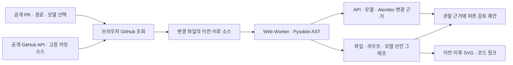

# PR 관련 코드 구조와 다음 확장

2026-11-24. 현재 구현·디자인 계약은 [DESIGN.md](../DESIGN.md)를 따른다. 공개 배포와 작업 진행 상태는 [실행 기록](FASTAPI_PR_TEST.md#현재-목표와-진행률)에서만 관리한다.

## 현재 구조에서 가능한 일

공개 체험판은 정적 사이트다. GitHub의 공개 PR과 비교 기준 커밋을 확인하고, 방문자 브라우저 안의 Python AST 분석기로 변경 파일을 읽는다. 고정 커밋의 저장소 Python 구조를 읽는 입력도 제공한다. 대상 소스는 실행하거나 import하지 않으며 운영 환경을 조사하는 서버는 없다. PR 구조도·저장소 탐색·목적별 계획·조건부 구조 비교는 [GitHub Pages](https://leegiyeon.github.io/Generate-Architectures/)에 공개 배포했다.

근거: `app/pr_preview/github.js::loadPull`, `analyzer-worker.js::initialize`, `scripts/pr_preview_browser.py::analyze`. 기존 로컬 `application_graph.py::build_application_graph`는 파일·함수·모델·라우트와 근거를 표현하지만, 렌더러는 Graphviz 프로세스와 로컬 저장소 분석에 의존한다. 브라우저에서는 기존 라우트·SQLModel 분석 함수를 재사용하고 SVG로 표시한다.

## 조회 범위와 취소

PR은 변경 목록 최대300개에서 지정 경로의 정확한 파일 또는 디렉터리 하위 경로를 먼저 선택한 뒤 Python 원본 최대100개를 읽는다. 지정하지 않으면 전체 변경 목록에 같은 한도를 적용한다. 모델·응답 모델 선택은 조회 경로를 넓히지 않는다. 이름 변경 파일은 현재 경로로 선택하고 이전 소스는 이전 경로에서 읽는다. 변경 목록300개 밖은 경로를 지정해도 읽을 수 없으며 결과에 생략을 표시한다.

PR 원본 캐시는 PR URL과 정렬·중복 제거·후행 슬래시 제거한 경로 조합으로 분리한다(4건·3분). 선택 범위의 원본 읽기가 실패하거나 취소되면 캐시하지 않는다. 기존 merge-base·fork 소스 조회와 조회 중 커밋 변경 검사를 유지한다.

PR·저장소 모두 조회 시작부터 Worker 분석 완료까지 하나의 90초 제한시간과 AbortSignal을 사용한다. `분석 취소`는 요청을 중단하고 실행 중인 Worker를 종료한다. 입력을 보존하고 해당 URL로 포커스를 돌려 재시도할 수 있다. 취소는 오류와 구분해 안내하며 늦은 진행 상태·결과를 표시하거나 중단한 응답을 캐시하지 않는다. 제한시간 초과는 범위 축소·네트워크 확인 안내를 표시한다. 종료한 분석기는 다음 분석 때 새로 만들고 성공한 분석기는 재사용한다. 관련 파일은 `app/pr_preview/{app,github,repository,worker-client}.js`이다.

## 이번에 추가한 기능

- PR 변경 파일의 이전·이후 구조를 전환한다. 기본은 이후 커밋이다.
- 파일에서 직접 선언한 라우트·테이블·데이터 모델을 연결한다. 각 구성요소는 해당 커밋의 파일·행으로 연결한다. 이름이 바뀐 파일의 이전 소스는 이전 경로를 사용한다.
- 추가·삭제·수정·동일을 직접 선언의 AST 기준으로 비교한다. 행 이동만으로 수정이라고 표시하지 않는다. 상속 모델의 선언이 동일해도 상위 모델 변경의 영향을 받을 수 있다.
- 구조와 변경 근거에 따라 API 계약 테스트, DB 호환성·배포 순서, 실제 API–DB 연결 확인을 제안한다. 이 제안은 운영 장애 진단이나 자동 재설계 결과가 아니다.
- SVG를 저장할 수 있다. 파일에는 PR·커밋·분석 범위 안내가 포함되며, 외부 연결 없이 이미지로 열 수 있다.
- 도표와 같은 구성요소의 HTML 근거 목록을 제공한다. 도표는 가로·세로 스크롤하고, 페이지 자체는 모바일 폭에 맞춘다.

읽은 이전·이후 중 한쪽이라도 없으면 두쪽 구조도에서 해당 파일을 제외하고 읽기 실패를 표시한다. 스냅샷별 최대 80개 노드를 표시하고 초과 개수를 알린다. 동적 라우트·간접 등록, 상속 필드 전파, 호출·DB 접근, 배포 인프라는 도표에 추측해서 연결하지 않는다. 함수 내부 라우트는 함수의 실제 호출 여부 미확인으로 표시한다. 추가 서버·의존성·OpenAI API·API 키는 필요 없다.

동일한 HTTP 데코레이터 후보의 경로·바인딩을 한쪽에서 확정하지 못하면, 라우트를 양쪽 구조 비교에서 제외하고 미확인 경로를 표시한다. 해석 실패를 실제 추가·삭제로 취급하지 않는다. 필드 선언 문자열은 코드 위치처럼 보이는 내용이 있더라도 근거 링크로 해석하지 않는다.

## 저장소 현재 구조 — 공개·로컬 지원

‘저장소 현재 구조’에서 공개 저장소 URL·Python 소스 루트를 입력한다. 커밋 SHA는 선택이며, 비우면 기본 브랜치의 최신 커밋을 조회해 전체 40자리 SHA로 고정한다. 이후 파일 목록·소스·근거 링크·캐시는 고정 SHA를 사용한다. 다시 분석하면 기본 브랜치를 재확인하며, 직접 입력한 SHA를 다른 버전으로 대체하지 않는다. 예를 들어 `backend/app`을 `app`으로 import하는 프로젝트의 소스 루트는 `backend`이다. 자동으로 `src`나 다른 루트를 추정하지 않는다. 예제는 full-stack-fastapi-template의 커밋 `d0defd5a92bfcd35ccea93873519816a2252a97e`·루트 `backend`이다.

GitHub 메타데이터 → Git commit의 tree SHA → recursive tree → 고정 SHA 원본을 읽는다. tree가 잘리면 전체 목록으로 간주하지 않고 오류로 중단한다. 원본은 일반 Python 파일100개·파일당64KiB·동시6개로 제한한다. 선택한 커밋·루트의 성공한 원본만 2건·3분 캐시하며, 읽기 실패·중단은 캐시하지 않는다. API 조회는 3회이며 원본 조회는 별도이다. 근거: [GitHub Git commits](https://docs.github.com/en/rest/git/commits#get-a-commit), [Git trees](https://docs.github.com/en/rest/git/trees#get-a-tree).

파일을 선택하면 그 파일이 참조하는 모듈 또는 그 파일을 참조하는 파일을 전환한다. module-level의 직접 import를 사용자 소스 루트에 맞춰 `module.py` 또는 `module/__init__.py`로 유일하게 대응할 수 있을 때만 연결한다. 각 관계는 원래 import문의 커밋·파일·행으로 연결한다. 기존 `declarations()`를 재사용해 라우트·핸들러와 SQLModel 테이블의 직접 선언도 보여준다. 빈 `__init__.py`는 유효한 파일로 유지한다.

- 상위 경로가 일반 모듈이거나 패키지 후보가 여러 개·읽기 실패이면 자식 관계도 미확인이다. 원본100개 밖의 경로와 심볼릭 링크 경로도 충돌 확인에 사용하며, 그 소스를 읽었다고 표시하지 않는다.
- `from package import child`는 명시한 `package` 파일까지만 연결한다. 재수출된 이름이나 실제 child 로딩을 추정하지 않는다. 조건부·함수 내부·동적 import, 외부 패키지 또는 범위 밖의 대상은 미확인 목록에 남긴다.
- 화면은 파일80개·관계400개, 미확인100건·파일당선언20개로 제한하고 생략 수를 알린다. 선택 도표는 이웃12개를 표시하며 근거 목록에는 표시 범위의 나머지 관계도 유지한다.
- 이 도표는 직접 import 선언의 정적 대상이다. 전체 함수 호출, 실제 API–DB 접근, 최종 URL·라우터 등록, 배포·운영 인프라를 확정한 시스템 아키텍처가 아니다.

관련 파일: `app/pr_preview/{repository,repository-view}.js`, `scripts/repository_structure.py`. 기존 PR 모드와 Worker·AST 선언 분석·코드 링크·SVG 저장·스타일을 공유한다.

### 사용자 목적별 검토 계획 — 공개·로컬 지원

선택한 파일과 같은 분석 결과를 사용해 세 가지 목적의 계획을 전환한다. 참조 방향 선택은 도표에만 적용하며, 계획은 필요한 방향의 전체 표시 관계를 사용한다. 목적 변경에 GitHub 조회·Python 재분석·LLM은 필요 없다.

| 사용 목적 | 제공하는 확인 순서 |
| --- | --- |
| 온보딩 | 선택 파일의 직접 선언을 읽고, 명시한 import 대상의 역할을 확인 |
| 변경 검토 | 직접 import하는 사용 지점을 출발점으로 살펴보고, 라우트·테이블의 계약을 이전 버전과 수동 비교 |
| 테스트 계획 | 관찰한 라우트·모델 선언에 맞는 검증 조건과 import 대상의 테스트 준비 조건을 정리 |

각 항목은 현재 확인·다음 행동·완료 조건·고정 커밋의 코드 근거를 제공한다. 파일 수는 중복 대상을 제거한 수이며 전체 저장소의 실행 영향 수가 아니다. 관계 수는 import 구문 수와 다르며 한 구문이 여러 대상을 가리킬 수 있다. 근거 목록은 항목별 최대6곳과 정확한 생략 수를 표시한다. 그래프·선언·미확인 목록의 한도와 읽기 실패를 계획에도 남긴다. 관계가 없다는 이유로 영향 없음·미사용·테스트 없음이라고 결론 내리지 않는다.

`검토 계획 복사`는 저장소·전체 커밋 SHA·소스 루트·선택 파일·목적·확인 행동·근거 URL·한도를 텍스트로 복사한다. PR 요약·분석 설정 링크와 공용 복사 UI를 사용하며, 상태는 버튼 옆에 표시한다. 읽기 전용 수동 복사는 항상 펼칠 수 있고 자동 복사 실패 시 같은 텍스트를 자동 선택한다. 파일·목적·관점을 바꾸면 이전 복사 상태를 제거한다. 표시한 선언에 맞춘 규칙 기반 검토 계획이며 테스트 실행·변경 전후 비교를 수행한 결과, 운영 개선이나 제안 아키텍처의 검증 결과는 아니다. 관련 파일은 `app/pr_preview/repository-review.js`, `app/pr_preview/copy-output.js`이다.

### 현재 구조와 개선 후보 비교 — 공개·로컬 지원

선택 파일에 확인한 근거가 있는 두 가지 규칙에 한해 비교한다. 이미 읽은 선언·그래프를 사용하므로 후보 선택에 추가 조회·실행·LLM은 없다. 도표의 왼쪽은 현재 구조의 일부, 오른쪽은 적용하지 않은 가정이다. 제안 역할·새 관계는 점선과 가정 문구를 함께 쓰며 실제 새 파일 경로나 소스 링크를 만들지 않는다.

| 관찰 근거 | 비교하는 후보 | 별도 확인할 조건 |
| --- | --- | --- |
| 같은 파일에 라우트·테이블 직접 선언 공존 | 라우트 담당 역할과 테이블 담당 역할 분리, 실제 참조가 필요할 때의 import 추가 가정 | 공유 선언의 소유 위치·실제 사용 지점·등록·메타데이터·기존 import 경로 유지. 작은 예제는 분리 이점이 적을 수 있음 |
| 선택 파일로 돌아오는 직접 import 경로 | 가장 짧은 경로에서 선택 파일의 한 방향 참조를 조정한 뒤 제거하는 가정 | 모든 사용 이름과 동작을 보존하는 계약 이동·참조 방향 조정. 단순 import 삭제나 전체 순환 해결을 뜻하지 않음 |

후보마다 현재 확인·검토 이유·변경할 관계·적용 전제·순서·검증할 사항·단점·코드 근거를 제공한다. 근거는 최대6곳이며 생략 수를 표시한다. 순환은 alias·중복 import를 파일 쌍으로 묶고 가장 짧은 경로의 파일 최대6개만 비교한다. 긴 경로는 길이와 한도를 알리고 일부를 잘라 순환처럼 그리지 않는다. 표시 한도·읽기 실패·미확인은 후보와 텍스트에도 남긴다. 후보 없음은 지원 규칙·표시 범위에서 근거를 찾지 못한 상태이며 구조의 적절성 판정이 아니다.

‘구조 비교 예제’는 [SQLModel 공식 예제](https://github.com/fastapi/sqlmodel/blob/c392a113ef555f626301f56e01a3a0312ef20ee8/docs_src/tutorial/fastapi/simple_hero_api/tutorial001.py)를 사용한다. 고정 커밋은 `c392a113ef555f626301f56e01a3a0312ef20ee8`, 소스 루트는 `docs_src/tutorial/fastapi/simple_hero_api`이며 라우트2개·Hero 테이블1개의 공존을 보여준다. 공식 예제가 잘못됐다는 평가가 아니다. 원본의 작은 교육용 구성을 유지할 수 있다는 단점을 함께 안내한다.

비교 SVG에는 저장소·커밋·루트와 미적용 가정 메타데이터를 담고 공통 저장 helper로 외부 링크를 제거한다. ‘구조 비교 텍스트로 보기’는 같은 범위·전제·검증·단점과 실제 코드 근거 URL을 읽기 전용 텍스트로 제공한다. 관련 파일은 `app/pr_preview/repository-proposals.js`, `repository-view.js`이다. 코드 수정이나 제안 적용 후의 동작·성능을 검증하는 기능은 아니다.

## 이후 제안: 현재 구조 → 변경 영향 → 개선 후보

1. **현재 구현:** PR 범위의 코드 구조와 변경 근거를 함께 확인한다. 실제 공개 PR로 소스 링크·누락·한도를 검증한다.
2. **저장소 탐색 구현·공개 배포:** 고정 커밋·사용자 Python 소스 루트에서 직접 import와 선언을 탐색한다. 조회·파일·표시 한도를 적용했다. 라우터 등록·재수출·다른 언어는 미구현이다.
3. **구조 기반 개선 후보:** 목적별 확인 행동과 라우트·테이블 역할 분리·직접 import 순환 조정의 조건부 구조 비교를 구현·공개 배포했다. 일반적인 최적 아키텍처 선정·배포 인프라 설계는 미구현이다. 이후 확장도 확인된 그래프·코드·설정 근거와 사용자 제약만 사용하며, 트래픽·비용·운영 제약이 없으면 특정 클라우드나 분산 구조가 더 낫다고 단정하지 않는다.

2단계와 3단계는 Python의 직접 import·선언에 한정해 구현·공개 배포했다. 규칙 두 가지의 구조 비교를 지원하며 실제 코드 변경과 적용 결과는 검증하지 않는다. 이후 LLM을 도입하더라도 필요한 근거만 application layer에서 구성하고, 규칙 기반 분석과 구분해야 한다. 이번 버전에는 LLM을 도입하지 않았다.

비교 참고: [GitDiagram 공식 저장소](https://github.com/ahmedkhaleel2004/gitdiagram)는 저장소 아키텍처 시각화와 코드 연결을 제공한다(2026-11-24 확인). 우리 서비스는 현재 PR의 변경 전후와 확인 가능한 선언 근거를 연결하는 범위로 구현했다. 사용자 수요나 우월성을 검증한 결과는 아니다.

Alembic 타입 변경의 의미는 [공식 alter_column 문서](https://alembic.sqlalchemy.org/en/latest/ops.html#alembic.operations.Operations.alter_column)에 따라 처리한다. `existing_*`는 기존 상태의 선언이며, 실제 변경 옵션과 구분한다.

다음 우선순위(P2)는 저장소 모드의 선택 파일·목적·커밋·루트를 담은 설정 공유다. 이번 조회 정확성·취소 개선에는 포함하지 않는다.
